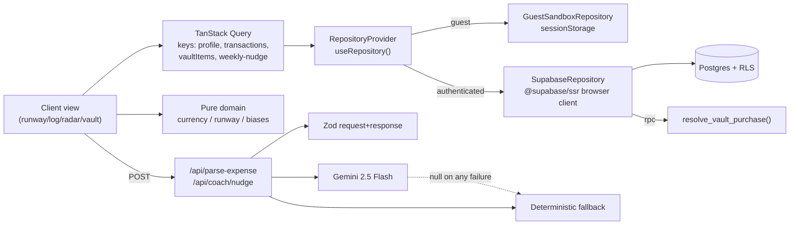

# StopBucks — Independent Engineering Audit (After Phase 2)

**Audit date:** 2026-11-23
**Auditor role:** Independent Principal Engineer / Full-Stack Architect / AppSec / DB Engineer / QA Lead
**Scope:** Entire repository at `/Users/binayakroy/StopBucks` — Phase 1 foundation + Phase 2 (interactive views, Gemini routes, CSV export, Vault atomicity)
**Mode:** Read-only audit. No application code, schema, test, or dependency was modified. The only file created is this report.
**Environment:** macOS, Node/Next 16.4.6 dev server on `http://localhost:3000` (PID 38697, pre-existing). No Supabase project credentials and no `GEMINI_API_KEY` are configured, so all live-backend paths are marked **unverified**.

---

## 1. Executive Summary

### Project status
StopBucks is a working, locally runnable Next.js 16 behavioral-finance app with a genuinely well-designed domain layer, a clean dual-mode repository abstraction, and four functional views. The **guest sandbox path is the only path that could be exercised end to end**, and it works. The **authenticated Supabase path and the live Gemini path are implemented but unverified** in this environment.

### Overall engineering assessment
The engineering quality is above typical prototype level: money is stored as integer minor units, financial computations are pure and unit-tested, Zod guards every external boundary, and Gemini is treated as an optional accelerator with a deterministic fallback. The two weakest dimensions are (a) **identity/session hygiene in the client cache**, and (b) **verification honesty** — the previously reported "113/113 passing" suite is currently **red (112/113)**, and the failure exposes a real data bug rather than a broken test.

### Phase 1 / Phase 2 assessment
| Area | State |
|---|---|
| Domain layer (currency, runway, biases, parser, nudge) | **Implemented, pure, well tested** |
| Repository abstraction + guest sandbox | **Working and locally verified** |
| Supabase schema + RLS | **Implemented, reviewed, not executed** (no database) |
| Vault atomic purchase | **Implemented twice** (RPC + guest single-write); RPC unexecuted |
| API routes (`/api/parse-expense`, `/api/coach/nudge`) | **Working via fallback**; Gemini success path never executed |
| Four views (Runway/Log/Radar/Vault) | **Working**, no horizontal overflow at 375px, no console errors |
| CSV export | **Working, unit tested** (browser download not exercised) |
| Test suite | **112 passed / 1 failed / 113 total** |
| PWA | Manifest + icons only; **no service worker, no offline behaviour** |

### Major strengths
1. Monetary precision is a first-class invariant (`src/domain/currency.ts`), and the parser avoids float math for amounts (`parseAmountStringToMinor`).
2. The same domain functions drive every view; no dashboard value is hardcoded or invented.
3. Gemini is never a point of failure: schema-constrained output, response re-validation, timeout, and a deterministic fallback that is unit tested.
4. The Vault "Still Bought It" path refuses to run through the generic resolution method, and the authenticated variant is a single `SECURITY INVOKER` PL/pgSQL function with `FOR UPDATE`.
5. RLS exists on all four tables for all four verbs, and repository queries *also* filter by `user_id` (defence in depth).

### Major weaknesses
1. **No identity scoping of the TanStack Query cache** and no sign-out control: guest data can be served to an authenticated session for up to the 2-minute `staleTime` (`DATA-001`, `ARCH-002`).
2. **Month aggregation has no upper time bound**, so future-dated rows count as already spent; the guest seed dataset itself writes a transaction dated in the future (`FIN-002`, `TEST-001`).
3. **All calendar math runs in UTC** while the product is aimed at IST/HKT students, so month boundaries and "days remaining" shift by 5.5–8 hours (`FIN-001`).
4. **Rescuing a Vault item has no unlock-time gate** in either repository, while purchasing does (`DATA-003`).
5. **Onboarding never invalidates `["profile"]`**, so a user can save a baseline and still be told they have none (`DATA-004`).
6. The riskiest code — `SupabaseRepository`, RLS, the RPC, provider auth transitions — has **zero automated coverage** (`TEST-002`).

### Overall readiness
**Not production-ready.** Suitable for a supervised demo (guest mode) and for continued development. Before Phase 3, the P1 list in §17 should be closed; the suite must be green and deterministic first.

---

## 2. Project Architecture Overview

### Actual architecture
- **App Router**, all four feature routes are client components that fetch through TanStack Query. No route uses server-side data fetching; the build marks `/runway`, `/log`, `/radar`, `/vault`, `/onboarding`, `/` as static (`○`) and the two API routes + `/auth/callback` as dynamic (`ƒ`).
- **Pure domain layer** (`src/domain/*`) with no React/Supabase/network imports — verified.
- **Repository interface** (`IStopBucksRepository`) with two implementations: `GuestSandboxRepository` (sessionStorage) and `SupabaseRepository` (Supabase JS + RLS).
- **Context providers**: `RepositoryProvider` (mode + repository instance), `DisplayPreferenceProvider` (Pain-of-Paying), `QueryClientProvider`.
- **Server surface**: two POST routes, one auth callback, `src/proxy.ts` (Next 16 request interception) for Supabase cookie refresh.
- **Database**: 2 SQL migrations, 4 tables, 4 enums, RLS, 1 RPC.

### Module map
```
src/
├── app/
│   ├── (app)/{runway,log,radar,vault}/page.tsx   # feature views (client)
│   ├── (app)/layout.tsx | error.tsx              # shell + boundary
│   ├── api/parse-expense/route.ts                # NL expense parsing
│   ├── api/coach/nudge/route.ts                  # weekly experiment
│   ├── auth/callback/route.ts                    # PKCE exchange
│   ├── onboarding/page.tsx | page.tsx (landing)
├── domain/      types, currency, behavioral-engine, runway-insights,
│                expense-parser, nudge, seed-data
├── repositories/ interface, guest-sandbox, supabase, provider
├── lib/         schemas(zod), gemini, rate-limit, csv, chart-format,
│                query-keys, display-preference-context, supabase/{client,server}
├── components/  dashboard(4), quick-log(2), bias-radar(3), vault(3),
│                shared(4), ui(9 shadcn-style)
supabase/migrations/0001_initial_schema.sql, 0002_vault_purchase_rpc.sql
test/ 10 files, 113 tests
```

### Data flow


### External dependencies (direct)
`next@16.4.6`, `react@19`, `@tanstack/react-query@5`, `@supabase/ssr@0.5`, `@supabase/supabase-js@2.49`, `@google/genai@3.6.1`, `recharts@2.15`, `zod@3.24`, Radix primitives (dialog/label/select/slot/tabs), `sonner`, `lucide-react`, `class-variance-authority`/`clsx`/`tailwind-merge`, Tailwind 4 (PostCSS). Dev: `typescript@5.7`, `vitest@3`, `eslint@9` + `eslint-config-next`.

**Dependency usage check:** every runtime dependency is imported somewhere (`tabs.tsx` and `label.tsx` exist; `@radix-ui/react-tabs`/`-label` are only used by those wrappers — `Tabs` is not used by any feature component, so the tabs primitive is effectively dead weight, see `ARCH-004`). No duplicate libraries for the same job. No dependency is misplaced between `dependencies`/`devDependencies` (all build-time tools are dev-only). `package-lock.json` is present and consistent with `package.json`; the installed tree resolves.

### Boundaries — as found
| Boundary | Respected? |
|---|---|
| UI → repository (never Supabase directly) | ✅ except `src/app/page.tsx` imports `createClient` for magic-link sign-in (acceptable, no data access) |
| Domain independent of React | ✅ no React imports in `src/domain` |
| sessionStorage only inside guest repo | ✅ only `repositories/guest-sandbox.repository.ts` and the guest-flag key in `repository-provider.tsx`/`display-preference-context.tsx` (localStorage) |
| Money as integer minor units | ⚠️ one write path converts via `parseFloat` (`FIN-004`) |
| Gemini key server-only | ✅ `GEMINI_API_KEY` read only in `lib/gemini.ts`, imported only by API routes |

---

## 3. Audit Methodology

### Files inspected (all read in full unless noted)
Root config (`package.json`, `tsconfig.json`, `next.config.ts`, `eslint.config.mjs`, `vitest.config.ts`, `components.json`, `.gitignore`, `.env.example`, `public/manifest.webmanifest`); all 6 domain modules; all 4 repository modules; both migrations; both API routes; `auth/callback`; `proxy.ts`; `lib/{gemini,rate-limit,csv,chart-format,query-keys,schemas,display-preference-context,utils}`; `lib/supabase/{client,server}`; `app/{layout,page,error}`; `(app)/{layout,error}` and four pages; all 4 dashboard, 2 quick-log, 3 radar, 3 vault, 4 shared components; 9 `ui/*` primitives; all 10 test files.

### Commands executed
`npm run typecheck`, `npm run lint`, `npm test`, `npm run build` (full output in §13); `find` over `src/supabase/test/public`; `curl` against the running dev server; browser inspection of `/runway`, `/log`, `/vault` at 375px (viewport + DOM + console/network); a targeted read of `@supabase/ssr` internals to confirm non-browser `createBrowserClient` behaviour.

### Testing methods
Static review of every financial formula against its specification and its tests; independent recomputation of the expected values in the tests (e.g. `1,600,000 − 550,000 = 1,050,000`, `/21 = 50,000` minor → ₹500); reading the failing test's output and reproducing its root cause in the live UI; RLS policy enumeration by verb and table; manual trace of cache keys across mode transitions.

### Environmental limitations
- **No Supabase credentials** → schema never applied, RLS/RPC never executed, no login/logout/account-isolation test, no `SupabaseRepository` call ever made.
- **No `GEMINI_API_KEY`** → the model branch of both routes never executed; observed responses are `source: "fallback"`.
- No profiling, no Lighthouse, no device lab, no accessibility tooling. Performance and a11y statements are **code-level**, not measured.
- Visual check covered three routes at 375px only; `/radar`, tablet and desktop layouts were not re-measured in this pass.

### Scope exclusions (per instruction)
No remediation implemented, no refactoring, no Phase 3 work, no git/remote administration, no dependency upgrades, no production data (none exists locally).

---

## 4. Architecture & Code Quality Findings

### Separation of concerns
Strong at the domain/repository boundary, weaker inside the API routes and a few components.

- Domain functions are pure and reused everywhere; there is **no duplicated financial formula in components** — verified by searching for arithmetic on `amountMinor`/budget outside `src/domain` (only display-level division in `safe-to-spend-hero.tsx:41-46` for "daily baseline"/"average daily spend", which duplicates a *concept* but not the runway formula).
- `bias-radar/weekly-coach.tsx` re-implements the "never leave the student without a plan" fallback (`:88-107`) that the API already guarantees — duplicated policy, acceptable but worth noting under `ARCH-006`.
- Prompt text and the savings cap live inside `api/coach/nudge/route.ts:66-135` while the equivalent rule lives in `domain/nudge.ts:95-105`; the two disagree (`API-004`).
- Components are mostly 100–330 lines; the largest are `quick-log-form.tsx` (~330) and `transaction-ledger.tsx` (~340). Both mix form state, mutations, CSV export and presentation. `ARCH-005`.
- Feature pages duplicate the same loading/error/empty scaffolding four times (acceptable, explicit) but each page is a client component with its own `useQuery` block.

### TypeScript
`strict: true`, no `any` in application code (only inside vendored `.d.ts`), no non-null assertions outside tests. However:
- `SupabaseRepository` casts raw rows (`data as DbTransaction[]`, `row.trigger_tag as Transaction["triggerTag"]`, `row.bias_snapshot as unknown as BiasAnalysisResult`) without runtime validation — the enum casts make an out-of-range DB value silently become a domain value (`DATA-002`).
- `getProfile`/`createProfile`/`updateProfile` repeat the same 8-line row→domain mapping three times (`ARCH-003`).
- `WeeklyNudge.coachResponse` is `Record<string, unknown>` and is re-parsed at display time (`weekly-coach.tsx:34-40`) — reasonable, but the stored snapshot is never re-validated.
- `VaultPurchaseResult` returned from an RPC is hand-validated (`supabase.repository.ts:455-470`); good, but only shape, not types.

### Component architecture
- Prop drilling is shallow (max 3 levels); no unnecessary global state.
- `useEffect` cleanup is correct for the one interval in the app (`cooling-item-card.tsx:40-44`).
- `referenceDate = useMemo(() => new Date(), [])` in `runway/page.tsx:99` freezes "now" for the page's lifetime — a long-lived tab will not roll over at midnight (`DATA-008`).
- Optimistic update exists only for `addTransaction` with rollback (`quick-log-form.tsx:63-107`); delete/purchase are plain invalidations. Consistent enough.
- Loading (skeletons), empty and error states exist on all four pages — a genuine strength.
- No component-level error boundary around charts; a Recharts throw would take the page to `(app)/error.tsx` (acceptable).

### Dependency health
- Versions are recent and mutually compatible; `@google/genai` 3.6.1 accepts plain schema objects (`SchemaUnion`).
- `@radix-ui/react-tabs` is only consumed by an unused wrapper; `recharts` is used on 3 routes and is the heaviest client dependency (~5.3 MB unpacked) (`PERF-002`).
- No peer-dep warnings in the build; `package-lock.json` is consistent.
- Risk: `next@16.4.6` + `react@19` is bleeding-edge; no upgrade performed or recommended during audit.

### Technical debt
`ARCH-001` (SSR-time browser client), `ARCH-004` (dead exports), `ARCH-003` (mapping duplication), plus the 4× duplicated page scaffolding. All low-to-medium; none block correctness today.

---

## 5. Financial Engine Audit

### A. Monetary precision — **sound, with one leak**
- Storage and transport are integer minor units everywhere (`types.ts:4-8`, all SQL columns `BIGINT`, all Zod schemas `.int()`).
- `toMinorUnits` rounds a float product (`Math.round(amountMajor * 100)`, `currency.ts:56`) and then rejects unsafe integers. It is correct for two-decimal inputs (the tests cover `19.99`) but the domain's better tool — exact decimal-string parsing — is used only by the parser. `onboarding/page.tsx:80-82` and `park-impulse-form.tsx:56` feed `parseFloat` output into `toMinorUnits`, so inputs like `1.005` or `0.1+0.2` can drift by one minor unit (`FIN-004`).
- `formatCurrency` handles zero/negative correctly (`-$50.00`), and every currency uses `minorPerMajor = 100` — correct for INR/HKD/USD, but the constant is not derived from the currency config, so a future zero-decimal currency would be mis-handled.
- Rounding is `Math.round` in three places (safe-to-spend, savings, compounded); all are documented. No negative-money writes are possible (`amount_minor > 0` CHECK, `toMinorUnits` throws on negatives).

### B. Runway calculations
Formula as implemented (`behavioral-engine.ts:150-200`):
```
consumptionBudget   = max(0, monthlyBudget) − min(monthlyBudget, max(0, selfInvestTarget))
remaining           = max(0, consumptionBudget − MTD_consumption)
daysRemaining       = max(1, daysInMonth − dayOfMonth + 1)
safeToSpendToday    = round(remaining / daysRemaining)
isOverBudget        = MTD_consumption > consumptionBudget
```
Independently verified against tests: Nov 10, budget ₹20,000, target ₹4,000, spend ₹5,500 → 1,600,000 − 550,000 = 1,050,000 / 21 = 50,000 = ₹500.00 ✅. Last-day (`daysRemaining = 1`) and leap-February (29) cases are correct.

Boundary conditions checked:
| Case | Behaviour |
|---|---|
| Zero budget | `consumptionBudget = 0`, `safeToSpend = 0`, `isOverBudget` only if spend > 0 ✅ |
| Negative remaining | Clamped to 0, `safeToSpend = 0` ✅ |
| No transactions | Full budget spread over remaining days ✅ |
| Spend > budget | `isOverBudget = true`, progress capped at 100 ✅ |
| Month transition | `getDaysInMonth` uses `Date.UTC(y, m+1, 0)` — correct lengths ✅ |
| **Future-dated row** | **Counted as spent** — no `tDate <= referenceDate` bound (`behavioral-engine.ts:163-175`) ❌ `FIN-002` |
| **Non-UTC user** | **Month/day computed in UTC** because no `timeZone` is passed by any caller (`runway/page.tsx:101`, `radar/page.tsx:41`) ❌ `FIN-001` |
| Progress classification | `tight_runway` when spent% > linear% + 8 points; overspent at 100%/over budget ✅ (tests cover 30/45/100%) |

### C. Mental accounting — **correct**
- `invest_self` is excluded from MTD consumption and from the burn series (`runway-insights.ts:118`, tests confirm no jump on the investment day).
- Investment target and progress are computed independently (`mental-accounting.tsx:32-48`), clamped at 100%.
- Growth-to-Burn handles zero denominators deterministically (`0 → 1.0` if investment > 0, else `0.0`). The `1.0` fallback is arbitrary but documented and tested; it is also the one number in the UI that silently changes meaning when consumption is zero (`FIN-007`, informational).
- Trigger aggregation is correct and its denominators are explicit: consumption triggers vs consumption spend, `invest_self` vs total spend (`runway-insights.ts:180-215`, tested 10/33 percentages).

### D. Pain-of-Paying — **consistent, one fallback asymmetry**
- Currency: `symbol + Intl.NumberFormat(locale)`.
- Work hours: `amount_minor / hourlyRateMinor`, rounded to 1 decimal (`currency.ts:120-130`).
- 4-year: `amount * 1.08^4`, rounded to minor units → ₹1,000 becomes ₹1,360.49 (verified by test).
- All three modes are driven by one formatter (`formatMinorUnits`) reached through `useDisplayPreference().formatAmount`; I searched for monetary output that bypasses it: charts use `formatAxisValue`/tooltip `formatAmount`, ledger/vault/radar/cards all use `formatAmount`, CSV intentionally exports raw currency. **No bypassing display found.**
- Asymmetry: `formatMinorUnits(..., "work_hours", 0)` falls back to currency, but `convertToWorkHours(x, 0)` returns `0` — two different "missing hourly rate" semantics (`FIN-005`).
- Assumptions (8% annual, 4 years, 100 minor units) are hardcoded in `currency.ts:143-149` with no config surface (`FIN-008`).

### E. Behavioral calculations
All four detectors are pure, deterministic, and free of `NaN`/`Infinity` (guarded denominators). Specifically:
- **Late-Night Drift**: 22:00–04:00 local *or* `stress_late_night`, de-duplicated per transaction (test proves 1 count for a row satisfying both). Score = `min(100, round((spend%*2 + count%)/300*100))` — a monotone but arbitrary curve; the transformation is undocumented in the UI.
- **Cashless Numbness**: `cashless && amount ≤ 1.5% of monthly budget`; score = `min(50, count*6) + min(50, spend%*2.5)`.
- **Payday Burn**: share of consumption in days 1–7 of the month, piecewise curve with healthy anchor 23% — matches its documentation.
- **Social FOMO**: `fomo% * 2`, capped at 100.
- Composite = `0.30·lateNight + 0.25·cashless + 0.25·payday + 0.20·fomo`; weights are arbitrary but stable.

Evidence correspondence: `count`, `totalAmountMinor` and `percentage` are computed from the same transaction set that the card displays, so the numbers are consistent. **However the window is the entire ledger, not a week or the current month** — `detectPaydayBurn` pools days 1–7 across every month present, and the radar labels the output "Week 2026-W47" while the analysis covers all history (`FIN-006`). This is the most misleading behaviour in the financial engine.

---

## 6. Repository & Data Consistency Audit

### A. Repository parity
| Method | Guest | Supabase | Parity |
|---|---|---|---|
| `getProfile` | seeded/ad-hoc object | RLS row | ✅ |
| `createProfile` | overwrite | insert (PK conflict on retry) | ⚠️ `SEC-005` |
| `updateProfile` | partial merge | partial update | ✅ |
| `getTransactions` | sorted `loggedAt` desc | `order("logged_at", desc)` | ✅ |
| `addTransaction` | id prefix `tx-guest-` | DB uuid | ✅ (ids differ by design) |
| `updateTransaction` | throws if missing | `.single()` error if missing | ✅ |
| `deleteTransaction` | throws if missing | no error if id absent | ⚠️ minor asymmetry |
| `addVaultItem` | +48h unlock, status cooling | +48h unlock, status cooling | ✅ |
| `resolveVaultItem(rescued)` | status check, **no unlock check** | `status=cooling` filter, **no unlock check** | ✅ parity, both under-enforce (`DATA-003`) |
| `resolveVaultPurchase` | single copy-then-write | RPC | ✅ different mechanism, same contract |
| `simulateVaultUnlock` | mutates unlockAt | throws | ✅ intended |
| `get/saveWeeklyNudge` | per-key map | `upsert onConflict user_id,week_key` | ✅ |
| `resetDemo` | reseeds | throws | ✅ intended |

Guest shortcuts do **not** bypass domain logic: the views compute runway/biases from the returned rows in both modes, so the guest demo cannot show a "nicer" number than the real app would.

### B. Data consistency
- Logging an expense updates ledger, runway, radar and trigger breakdown because all derive from `["transactions"]` and all write paths invalidate it (`quick-log-form.tsx:125-128`). Verified by integration tests and by the running app.
- Deleting invalidates `["transactions"]` + `["profile"]` (`transaction-ledger.tsx:77-78`).
- Vault purchase invalidates vault, transactions and profile (`vault/page.tsx:37-41`) — correct, because a purchase is a transaction.
- Rescue creates no transaction and increases Money Rescued only (`calculateMoneyRescuedMinor` filters `status === "rescued"`).
- Investment stays out of consumption in both modes (shared domain code).
- Weekly nudges persist and rehydrate; guest keeps a per-week map, authenticated upserts on the unique `(user_id, week_key)`.

### C. TanStack Query
- Keys are centralised (`lib/query-keys.ts`) and consistent across views. Good.
- **No key is scoped by user or mode** (`["profile"]`, not `["profile", userId]`), and the provider never clears the cache when the active repository changes. A guest→authenticated transition inside one tab therefore serves cached guest data for up to `staleTime` = 2 min (`providers.tsx:14-22`). Risk of showing one account's data to another if a sign-out control is later added (`DATA-001`, HIGH).
- Optimistic add rolls back on error; concurrent adds both `unshift` into the same cache array, so a double submit would render two optimistic rows until refetch. The submit button is disabled while pending, which mitigates it.
- `refetchOnWindowFocus: false` + 2-minute `staleTime` means cross-tab edits can be invisible until a manual refetch. Acceptable for a single-device student app, documented here.
- Race: `onMutate` cancels in-flight `transactions` queries before writing — correct.

### D. Guest isolation
- Storage key `stopbucks_guest_sandbox_v1` (`guest-sandbox.repository.ts:31`) is never read by the Supabase path, and the Supabase path never writes it. Isolation is structural, not incidental. ✅
- Reset Demo restores seed state and invalidates the whole cache (`guest-banner.tsx:15-25`). ✅
- Storage failures: `setItem` throws are caught and only warn (`guest-sandbox.repository.ts:88-96`), but `resolveVaultPurchase` deliberately lets a thrown persistence error propagate so both records stay unchanged (test `vault-resolution.test.ts:150-175`). This distinction is deliberate and correct.
- **Caveat:** two `GuestSandboxRepository` instances in one browser tab keep separate in-memory copies over the same key and can overwrite each other (last write wins). The test that claims isolation (`integration.test.ts:145-160`) only holds because Vitest has no `window` (`DATA-006`).

### E. Authentication transitions
- `onAuthStateChange` sets authenticated + removes the guest flag; sign-out restores guest/none (`repository-provider.tsx:126-160`).
- **No sign-out UI exists** anywhere (`signOut` appears nowhere in `src/`), and `exitGuestMode` is exported but never consumed (`ARCH-002`). A user who enters the sandbox is stuck in guest mode for the tab's lifetime unless they close the tab.
- `activeMode === "none"` resolves to the **guest repository** and `isGuest` becomes `true` (`repository-provider.tsx:160-170`), so deep-linking `/runway` shows the seeded demo dataset with the Guest banner, without the user ever choosing it. This contradicts the file's own header comment ("Guest mode must be explicitly activated").
- No route guard exists on the authenticated pages: there is no redirect to `/onboarding` or `/` when unauthenticated.
- Cache contamination across transitions is the material risk (`DATA-001`).

---

## 7. Database & Security Audit

### A. Schema correctness (reviewed statically — not executed)
- 4 tables, all with `user_id UUID NOT NULL REFERENCES auth.users(id) ON DELETE CASCADE`; `profiles.user_id` is the PK.
- Enums are real Postgres enums for `trigger_tag`, `payment_mode`, `vault_status`; currency is a `TEXT` + `CHECK` (inconsistent style but equivalent).
- Money is `BIGINT` with `CHECK >= 0` (profiles) / `> 0` (transactions, vault) — correct.
- `self_invest_target_minor <= monthly_budget_minor` enforced in SQL, matching the Zod refinement. ✅
- `weekly_nudges` has `UNIQUE (user_id, week_key)`, which is exactly the `onConflict` used by the repository. ✅
- Indexes: `(user_id, logged_at DESC)`, `(user_id, trigger_tag)`, `(user_id, status)`, `(user_id, created_at DESC)`, `(user_id, created_at DESC)` on nudges. Query shapes are covered; no redundant index.
- Missing: `updated_at` columns, `CHECK` tying `status` to `resolved_at`, and a signup trigger to provision `profiles` (`DB-001`, `DB-002`).

### B. Row-Level Security — **complete and correct by inspection**
All four tables enable RLS and define SELECT / INSERT / UPDATE / DELETE for the owner, using `auth.uid() = user_id` in both `USING` and `WITH CHECK` for UPDATE (`0001_initial_schema.sql:86-156`). No policy uses a client-supplied id, no table is left without a policy, and no `auth.role()` shortcut exists. Because `resolve_vault_purchase` is `SECURITY INVOKER`, the RPC inherits these policies for both the `SELECT … FOR UPDATE` and the `INSERT`/`UPDATE`. A user cannot read or mutate another user's rows through the API or through the RPC.

### C. Database functions
`resolve_vault_purchase(p_vault_item_id UUID)` (`0002_vault_purchase_rpc.sql`):
- `SECURITY INVOKER` ✅ (no privilege escalation), `SET search_path = public` ✅ (no search-path hijack), `REVOKE ALL … FROM PUBLIC` + `GRANT EXECUTE … TO authenticated` ✅.
- Rejects anonymous callers (`AUTH_REQUIRED`), missing items, already-resolved items, and still-cooling items.
- All identifiers are static; the only parameter is bound via PL/pgSQL variables → **no SQL injection surface**.
- Rows are locked with `FOR UPDATE`, so concurrent "Still Bought It" taps serialize; the second call hits `VAULT_ITEM_ALREADY_RESOLVED`.
- No `EXCEPTION` block, so any failure rolls back the whole function — no partial state.

### D. Vault atomicity — **correct by construction, unexecuted**
Guest: a single `saveToStorage(nextPayload)` built from copies, so a throw leaves both records untouched (test asserts this by monkey-patching `saveToStorage`). Authenticated: one PL/pgSQL function = one transaction; insert and status update commit or roll back together. The only gap is the **rescue** path, which is not atomic-with-anything by design but lacks the unlock-time gate (`DATA-003`). Client-side clock manipulation is harmless for purchases (server `now()`), and the UI only offers actions after the timer elapses.

### E. Migration integrity
Ordering is sane (`0001` then `0002`), `0002` is additive (`CREATE OR REPLACE FUNCTION`) and safe to re-run. No destructive statements. `0002` assumes `auth.uid()` context (fine) and `vault_items`/`transactions` from `0001` (declared dependency, but no version guard). No rollback script — acceptable for Supabase CLI workflows. **Both migrations are unapplied here**; no claim of database verification is made.

### F. Additional security observations
`SEC-001`–`SEC-005` in the register cover unauthenticated AI routes, the spoofable/unbounded in-memory limiter, raw DB error strings reaching toasts, absence of CSP/security headers, and the profile-insert race.

---

## 8. API & AI Audit

### A. Request validation — **strong**
Both routes: JSON parse guarded (400), Zod `safeParse` with field-level messages (400), input length ≤ 280 via schema *and* inside the parser, currency enum restricted to INR/HKD/USD, week key regex `^\d{4}-W\d{2}$`, and a full Zod schema for `bias_analysis`/`runway_metrics` (ints, 0–100 bounds, positive day counts). Malformed `bias_analysis` is rejected — verified by test.

### B. Gemini security & configuration
- Key read only in `src/lib/gemini.ts:20-24`, imported only by the two route files → it cannot reach the client bundle (no `NEXT_PUBLIC_` prefix).
- SDK usage is correct: `generateContent` with `responseMimeType: "application/json"` and a `responseSchema`; `temperature: 0.2`.
- 12 s timeout via `Promise.race`; every failure path returns `null`; the response is JSON-parsed inside `try`.
- Output is re-validated with Zod and re-checked against business rules (amount digits must appear in the input; savings capped at the remaining consumption budget).
- **No prompt-injection escalation**: the model's output only produces three low-risk display fields; it cannot write data.
- Weaknesses: the timeout does not abort the underlying request (`API-002`), failures are only `console.warn` (`API-003`), and the anti-hallucination digit check is loose (`API-001`).

### C. Expense parser
Tested behaviours (all passing): integers, decimals (`249.99 → 24999`, `19.9 → 1990`, `0.01 → 1`), Indian/Western thousands (`2,00,000 → 20000000`), currency-symbol stripping, trigger keyword families, empty input, no-amount rejection, `>280` rejection, invalid decimals and negatives rejected, trigger defaulting to `need`, and payment mode defaulting to `cashless`.

Defects/risks:
- **First-number bias** (`AMOUNT_PATTERN`, `expense-parser.ts:45`): `"2 coffees 80"` → ₹2.00. A real student phrasing such as `"3 beers 900"` would log ₹3 (`FIN-003`).
- `"500 cash lunch"` loses the explicit cash signal → `cashless` (`API-005`).
- The note is built by removing the *first* occurrence of the matched text (`buildCleanNote`), so `"100 for 100 ml"` leaves an odd note.
- Gemini path's `amountAppearsInInput` strips non-digits from the whole input and checks the integer digits as a substring: `180` matches input `1800` (`API-001`).
- Amounts are transmitted as decimal **strings**, never floats — a deliberate, correct decision.

### D. Behavioral coach
- Only aggregates are sent: bias names/scores/levels, consumption budget/spend, days remaining, safe-to-spend. **No notes, ids, emails or raw transactions** — verified in `buildPrompt` (`route.ts:66-105`).
- Primary bias selection and headline word-limit are enforced server-side (`limitHeadlineWords`, 15 words) and the fallback is deterministic and unit tested.
- Weekly caching is client-driven: the nudge is saved under the ISO week key and re-read on mount; repeated "Refresh" clicks regenerate and re-upsert (idempotent thanks to `onConflict`).
- Weakness: the Gemini path caps savings at `remainingConsumptionMinor` (which is 0 late in an over-budget month) while `buildDeterministicNudge` caps only at 20% of the bias exposure (`API-004`) — the same student can be shown two different "projected savings" depending on whether the model answered.
- The payload is fully client-supplied; a crafted request can obtain a nudge for fabricated metrics. Impact is limited to that caller's own response (`API-007`).

### E. Abuse protection
- Parse: 30 req/min per identifier. Coach: 10 req/min.
- Limiter is **process-local** (`Map`) → ineffective across serverless instances/horizontally scaled deployments, and **unbounded** (`SEC-001`, `SEC-002`).
- Identifier is the first `x-forwarded-for` hop, which the client can spoof when not behind a trusted proxy → trivial bypass, and one shared `"unknown"` bucket for all clients without headers.
- **Neither route requires authentication**, so the owner's Gemini quota is exposed to any caller who can reach the URL. Zod does not mitigate cost exposure.
- No request body size limit beyond Next's default; `Content-Length` is not checked, but the Zod max length bounds memory per request.

---

## 9. Feature-by-Feature Audit

### A. Runway Dashboard — **works; two time defects**
Verified in the browser at 375px: header, Safe-to-Spend hero (₹1,463.13 across 8 remaining days), pace badge, consumption/investment split, daily burn chart, trigger breakdown, three quick actions. No dashboard number is hardcoded — every figure traces to `calculateDailyRunway` / `buildDailyBurnSeries` / `buildTriggerBreakdown`.
- Safe-to-Spend, consumption vs investment, monthly progress, 8-point pace classification: correct.
- Daily burn series: excludes `invest_self`, excludes prior months, marks future days `null` (so the chart never implies future spending) — a good design choice.
- Ideal trajectory: `budget * day / daysInMonth`, correct.
- Defects: UTC month boundaries (`FIN-001`), future-dated rows counted (`FIN-002`), frozen `referenceDate` (`DATA-008`), "Average daily spend" divides by `currentDayOfMonth` (includes today's partial day) — a cosmetic bias.

### B. Quick Log & Ledger — **works; parser inputs need care**
Verified at 375px: 22 ledger rows, 22 mobile cards, desktop table hidden by CSS, search/filter controls, CSV button.
- Natural-language Auto-Parse calls `/api/parse-expense` and pre-fills every field; manual entry never depends on the network. Parse failures surface an inline amber message rather than blocking.
- Form validation: amount parsed with the exact decimal-string parser, note required, trigger/payment explicit, submit disabled while pending.
- Pre-log preview: `buildRunwayPreview` correctly shows safe-to-spend now/after and the remaining-budget delta, and explicitly explains that `invest_self` is protected. Correct for both trigger families (tested).
- Delete uses a confirmation dialog and invalidates dependent queries.
- CSV: RFC-4180 quoting (commas/quotes/newlines), UTF-8 BOM, CRLF, header `Date (UTC),Time (UTC),Description,Amount,Currency,Trigger,Payment Mode`, amounts exported as original currency (not the active display mode), filename dated, and export respects the signed-in/guest repository (no cross-user export possible because data comes from the repository). Empty-ledger export is blocked with a toast. **The actual file download was not exercised** (jsdom/browser download untested).
- Weaknesses: parser first-number bias (`FIN-003`), the ledger renders both table and card DOM (hidden by CSS — doubles the row count in the DOM, slightly heavier on low-end phones), timestamps shown in UTC (`UI-004`).

### C. Behavioral Radar — **works; window/labelling mismatch**
Verified structurally (not re-measured at 375px this pass): four-axis radar, four evidence cards with score bars and severity badges, deterministic advice panel, weekly coach card.
- Scores/evidence derive from the same transaction list the cards summarise.
- Empty state when every score is 0 ("Not enough signal yet").
- Weekly coach: loads a saved nudge for the ISO week, generates on demand, falls back deterministically on failure and still persists the fallback (good resilience), flags `Gemini` vs `Deterministic` honestly.
- **The analysis is all-time while the UI says "Week 2026-W47"** and the coach is "weekly" (`FIN-006`). Scores also never expire, so last semester's late-night orders still drive this week's advice.
- Refresh is unmetered in the UI; the server limiter is the only brake.

### D. Cool-Off Vault — **works; rescue gate missing**
Verified at 375px: Money Rescued hero (₹8,498.00 from the two seeded rescues), park form, one cooling card showing "30h 00m remaining" (correct: seeded `now + 30h`), history section.
- Parking creates `status: cooling` with `unlock_at = now + 48h` in both repositories.
- Countdown recomputes every second from `unlockAt − now`, cleans up its interval, and shows a progress bar over the elapsed window. Correct.
- Actions only render after unlock; guest gets an explicit "Simulate 48h Elapsed" control that moves `unlockAt` into the past **without changing status** (so the purchase gate is still exercised) — a thoughtful demo design.
- Purchases create exactly one transaction, with the original price/trigger and `cashless`, in both implementations; double-click is rejected; a still-cooling item is rejected; `resolveVaultItem("purchased")` is refused.
- **Rescue has no unlock-time check** in either repository (`guest:276-305`, `supabase:388-430`), so a programmatic call can rescue a cooling item and inflate Money Rescued. The UI hides the button, so this is an API-integrity gap rather than an observed user path (`DATA-003`).
- Countdown/`Unlocks <date>` use UTC slices while the countdown uses the device clock → an IST student can see a timer end "the next day" relative to the printed date (`UI-004`). A manipulated clock shows enabled buttons that the server correctly rejects (`UI-005`).

---

## 10. UI / UX & Accessibility

### Responsiveness — measured
| Route | Width | `documentElement.scrollWidth` | Console errors |
|---|---|---|---|
| `/runway` | 375 | 375 ✅ | none (React DevTools + HMR only) |
| `/log` | 375 | 375 ✅ | none |
| `/vault` | 375 | 375 ✅ | none |

Navigation: sidebar ≥ md, fixed bottom nav < md with `pb-24` compensation on `<main>` — no overlap observed. Cards are single-column at 375 and grid at ≥ sm/lg. Charts use `ResponsiveContainer` with fixed heights (h-64/h-72) — no overflow.
**Not measured:** 390px, tablet, desktop, `/radar`, long-note truncation, landscape, 200% zoom.

### Structure & semantics
- Landmarks exist (`header`, `nav`, `main`, `aside`), headings are hierarchical (`h1` per page, `h2`/`h3` inside cards).
- Radix Dialog provides focus trapping, `Escape`, and `aria-labelledby`/`aria-describedby` via `DialogTitle`/`DialogDescription` (always supplied by callers).
- Focus rings exist on `Button`, `Input`, `Select`, `Tabs`, dialog close; links rely on the browser default outline (not removed).
- Icon-only buttons carry `aria-label` (ledger delete) or an `sr-only` label (dialog close).
- Inputs have associated `<Label htmlFor>` in onboarding, quick log and vault, plus explicit `aria-label`s where a visible label is absent.

### Accessibility defects
1. **`maximumScale: 1` in `src/app/layout.tsx:23` disables pinch-zoom** — a WCAG 1.4.4 failure and a real problem for the ₹/number-heavy UI (`UI-001`, MEDIUM).
2. **Charts have no accessible alternative**: the Recharts SVGs carry no `role="img"`, title or description, and the Daily Burn chart's data has no tabular/text equivalent (the radar's data is duplicated in the cards, so that one is partially mitigated) (`UI-002`).
3. Trigger/payment-mode pickers are `<button aria-pressed>` groups with a `<Label>` that has no `htmlFor` and no `role="group"`/`aria-labelledby`; screen-reader users hear five unlabelled toggle buttons (`UI-003`).
4. Typography: many labels and badges are `text-[10px]` (`mental-accounting`, `safe-to-spend-hero`, cards) — below comfortable mobile reading size (`UI-006`).
5. No skip link; the sidebar repeats four links plus the bottom nav in the same DOM (one is CSS-hidden), so a screen reader encounters duplicate navigation.

### Usability
Empty/loading/error states are present everywhere and non-blaming in tone; toasts confirm destructive and financial actions. The one UX trap is onboarding: after saving, the runway can still say "Baseline profile needed" (`DATA-004`). Guest mode can appear without an explicit choice (`DATA-005`). No dark mode (not required).

---

## 11. Performance & Reliability

*Code-level review — no profiling or bundle measurement was performed (`PERF-004`).*

- **Server/client boundary:** all four feature routes are client components; data is fetched only after hydration, so every visit paints skeletons first. There is no server-rendered data path or streaming. Acceptable for a local-first app, but it is the single biggest TTFB/LCP trade-off.
- **Bundle:** `recharts` (~5.3 MB unpacked) reaches `/runway`, `/radar` and `/log`; it is the largest client dependency and is not lazy-loaded. `lucide-react` treeshakes per icon. `@supabase/supabase-js` + `auth-js` load on every route through the provider.
- **Network per page:** each page issues 2 repository queries; each Supabase call performs its own `auth.getUser()` (`supabase.repository.ts:63-70`), and `src/proxy.ts` performs another `getUser()` for the request — so a page load costs 3 auth round-trips plus 2 data queries. This is the largest avoidable latency (`PERF-001`).
- **Re-renders:** memoisation is used where it matters (`analyzeBiases`, burn series, previews); the 1-second countdown re-renders only the card subtree. No memo on `TransactionLedger`'s filtered rows, but the dataset is small.
- **Memory/leaks:** intervals are cleaned up; the only unbounded growth is the rate-limiter `Map` (`SEC-002`).
- **Reliability:** API routes cannot fail closed (deterministic fallback), vault transitions are atomic in both modes, and query errors render retryable states. Optimistic add rollback is implemented. The weakest reliability link is the frozen `referenceDate` and the UTC/timezone assumptions, which make numbers change with the calendar rather than with user action.
- **Low-end device risk:** medium — client-side charts and a 2-minute stale cache are fine, but the initial JS for three chart-heavy routes will be noticeable on a budget Android phone over campus Wi-Fi.

---

## 12. PWA & Deployment Readiness

- **Manifest** (`public/manifest.webmanifest`): name, short name, description, `start_url: "/"`, `display: standalone`, background/theme colours, two PNG icons (192/512) declared `"purpose": "any maskable"`. Missing `id` and `scope`; the same artwork is used for both purposes, so the maskable safe zone is unverified.
- **No service worker** exists anywhere in `public/` or `src/` → **no offline support, no runtime caching, no precache**. The app therefore cannot be described as offline-capable, and install behaviour depends entirely on the browser's manifest-only path.
- **Metadata** (`app/layout.tsx`): title, description, manifest, icon and apple-touch-icon sets, `themeColor` in the viewport export. No Open Graph/Twitter cards (not required).
- **Environment requirements:** `NEXT_PUBLIC_SUPABASE_URL`, `NEXT_PUBLIC_SUPABASE_PUBLISHABLE_KEY` (or the `..._ANON_KEY` fallback supported in code), `GEMINI_API_KEY` (server-only). `.env.example` is **malformed** (a literal `[TEMPLATE]` first line) and does not document the anon-key alias (`PWA-002`).
- **Build configuration:** `next.config.ts` contains only `reactStrictMode`; no `turbopack.root`, which produces the observed "package-lock.json … outside the current Git repository" warning (`PWA-003`). No security headers, no CSP, no `images` config, no rewrites (`SEC-004`).
- **Deployment blockers:** no target-specific config (no `vercel.json`, Dockerfile, or Workers adapter); both API routes declare `runtime = "nodejs"` and `dynamic = "force-dynamic"`, and `@google/genai` is a Node-oriented SDK — this constrains edge/Workers hosting. `/auth/callback` depends on the exact redirect URL being allow-listed in Supabase. None of this was deployed or tested.
- **Error handling:** two error boundaries (root + workspace), both retry-capable and non-technical in copy, though they log raw `error.message` to the console (`SEC-003` adjacent).

---

## 13. Testing & Verification Results

Exact commands run at 2026-11-23T03:23Z in the project root, sequentially, with exit codes captured:

| Command | Result | Details |
|---|---|---|
| `npm run typecheck` | **PASS** (exit 0) | `tsc --noEmit`, no output, no errors. |
| `npm run lint` | **PASS** (exit 0) | `eslint src test`, no warnings or errors. |
| `npm test` | **FAIL** (exit 1) | **112 passed / 1 failed / 113 total, 10 files** (382 ms). Failure: `test/integration.test.ts:36` — `expected 'Chai & biscuit canteen break' to be 'Integration dinner'`. |
| `npm run build` | **PASS** (exit 0) | Next 16.4.6 Turbopack. Compiled + TypeScript OK. Routes: `/` `○`, `/_not-found` `○`, `/api/coach/nudge` `ƒ`, `/api/parse-expense` `ƒ`, `/auth/callback` `ƒ`, `/log` `○`, `/onboarding` `○`, `/radar` `○`, `/runway` `○`, `/vault` `○`, Proxy (Middleware). One warning: `package-lock.json` outside the Git repo. |

Per-file test counts (from the suite contents): behavioral-engine 15, currency 19, guest-repository 7, validation 9, vault-resolution 10, runway-insights 20, integration 8, parse-expense 12, weekly-nudge 7, csv 6 = 113.

### Root cause of the failure (independently confirmed)
`src/domain/seed-data.ts:66` timestamps the first seeded transaction as **today at 11:30 UTC** (`relIso(0, 11, 30)`). When the suite runs before 11:30 UTC, that row is *in the future*, so `getTransactions()` (sorted `loggedAt` desc) returns it first and the newly added "Integration dinner" is no longer at index 0. Live evidence from the running app at `03:25:49Z`:

```
now: 2026-11-23T03:25:49.613Z
first ledger row: 2026-11-23 · 11:30 UTC | Chai & biscuit canteen break | ₹60.00
```

This is not a test bug alone: the ledger displays a purchase 8 hours in the future, and that row is counted in month-to-date consumption. The previously reported "113 passed" was obtained at a time of day when this row was already in the past (`TEST-001`, `FIN-002`).

### What the suite genuinely covers well
Currency precision and formatting; mental accounting; runway boundaries (incl. leap February, over-budget, last day); all four bias detectors; trigger denominators; preview deltas; vault resolution (rescued/purchased/duplicate/still-cooling/unknown/forced `purchased`/storage failure); guest reset; parser fallback incl. thousands separators; both API fallback routes (200/400/422); CSV escaping; cross-view integration; ISO week keys.

### Important untested behaviours
`SupabaseRepository` (every method), RLS and the RPC (never executed), provider auth/guest transitions, cache invalidation on mode change, onboarding → runway, Gemini success path (no SDK mock), rate limiting, component rendering, CSV file download, and date/timezone behaviour for non-UTC users.

---

## 14. Consolidated Findings Register

| ID | Category | Severity | Finding | File / Location | Recommended Action |
|---|---|---|---|---|---|
| FIN-001 | Financial | **HIGH** | All calendar/month math runs in UTC; IST/HKT users get shifted month boundaries and "days remaining" | `src/domain/behavioral-engine.ts:122-200`; callers `runway/page.tsx:101`, `radar/page.tsx:41` | Thread a user timezone (from `Intl.DateTimeFormat().resolvedOptions().timeZone`) into one reference-date pipeline |
| FIN-002 | Financial | **HIGH** | Future-dated transactions count as already spent; seed data creates one every day at 11:30 UTC | `behavioral-engine.ts:163-175`; `src/domain/seed-data.ts:66` | Bound the filter with `tDate <= referenceDate`; clamp seed timestamps to the past |
| FIN-003 | Financial | **MEDIUM** | Parser takes the first numeric token ("2 coffees 80" → ₹2) | `src/domain/expense-parser.ts:45` | Prefer the number next to a currency token, else the last plausible amount; add tests |
| FIN-004 | Financial | **LOW** | Float multiply + `Math.round` for major→minor; `parseFloat` at input | `src/domain/currency.ts:56`; `onboarding/page.tsx:80-82`; `park-impulse-form.tsx:56` | Parse decimal strings to minor units in all input paths; reject >2 decimals |
| FIN-005 | Financial | **LOW** | `work_hours` mode silently falls back to currency when rate is missing, but `convertToWorkHours` returns 0 | `src/domain/currency.ts:120-130,165-172` | Return one explicit "unavailable" contract and render it consistently |
| FIN-006 | Financial | **MEDIUM** | Bias analysis spans the entire ledger while UI labels it "Week …" / "weekly" | `src/domain/behavioral-engine.ts:210-420`; `radar/page.tsx:120-127`; `weekly-coach.tsx` | Add an explicit analysis window (current ISO week or current month) and state it in the UI |
| FIN-007 | Financial | **LOW** | Cashless-numbness threshold derives from monthly budget, not consumption budget; Growth-to-Burn zero-denominator returns 1.0 | `behavioral-engine.ts:243,88-99` | Document the chosen denominators in code/UI, or align them |
| FIN-008 | Informational | **INFO** | 8%/4-year compounding and 100 minor units are hardcoded assumptions | `src/domain/currency.ts:143-149` | Keep, but surface the assumption next to the "4-Yr Cost" control |
| ARCH-001 | Architecture | **LOW** | `RepositoryProvider` constructs a browser Supabase client during SSR; `createBrowserClient` then has no cookie storage and throws if auth writes | `repositories/repository-provider.tsx:54-62`; `lib/supabase/client.ts:23-33` | Create the client only in the browser (`useState`/`useEffect`), return `null` on the server |
| ARCH-002 | Architecture | **MEDIUM** | No sign-out / account-switch UI; `exitGuestMode` is exported but never used | `repository-provider.tsx:148-155` (no consumers) | Add sign-out + "leave sandbox" controls that reset the query cache |
| ARCH-003 | Architecture | **LOW** | Profile/transaction/vault row→domain mapping duplicated 3–5× | `repositories/supabase.repository.ts:76-300` | Extract typed mappers (also fixes DATA-002) |
| ARCH-004 | Architecture | **LOW** | Dead code: `TRANSACTION_DEPENDENT_KEYS`, `updateVaultItem` (no UI caller), `formatCurrency` re-export, unused `Tabs` | `lib/query-keys.ts:15`; `repository.interface.ts:45`; `lib/csv.ts:84`; `components/ui/tabs.tsx` | Remove or wire up |
| ARCH-005 | Architecture | **MEDIUM** | All feature routes are client components with duplicated query/error scaffolding; two components exceed 330 lines | `app/(app)/*/page.tsx`; `quick-log-form.tsx`; `transaction-ledger.tsx` | Extract shared query shell/hooks; split form vs ledger concerns |
| ARCH-006 | Architecture | **LOW** | Coach fallback policy duplicated in route and component | `api/coach/nudge/route.ts:139-146`; `weekly-coach.tsx:88-107` | Keep one server contract; UI should only display |
| DATA-001 | Data | **HIGH** | Query cache is not scoped by identity/mode and is never cleared on transition; guest data can be shown to an authenticated session (and vice-versa) | `components/providers.tsx:11-33`; `lib/query-keys.ts`; `repository-provider.tsx:110-165` | Include `userId`/mode in keys and `queryClient.clear()` on repository change |
| DATA-002 | Data | **MEDIUM** | DB rows are cast, never validated; enum strings become domain types unchecked | `repositories/supabase.repository.ts:76-300,455-500` | Validate reads with Zod (or generated DB types) at the boundary |
| DATA-003 | Data | **MEDIUM** | "Skipped It" has no unlock-time gate in either repository (purchase does) | `guest-sandbox.repository.ts:276-305`; `supabase.repository.ts:388-430` | Reject rescue while `unlock_at > now`; mirror in RLS/RPC or a second function |
| DATA-004 | Data | **MEDIUM** | Onboarding never invalidates `["profile"]`; stale `null` keeps "Baseline profile needed" | `app/onboarding/page.tsx:106-131` | `queryClient.invalidateQueries({queryKey: queryKeys.profile})` (and transactions on first run) |
| DATA-005 | Data | **MEDIUM** | Unauthenticated, non-guest visitors get the guest repository and are labelled guests without opting in; no auth guard on app routes | `repository-provider.tsx:160-170`; `app/(app)/layout.tsx` | Resolve `none` to a loading/redirect state instead of the sandbox |
| DATA-006 | Data | **LOW** | Two guest repository instances keep separate caches over one storage key (lost updates); the "isolation" test only passes in Node | `guest-sandbox.repository.ts:34-100`; `test/integration.test.ts:145-160` | Re-read storage before writes, or make the repo a singleton |
| DATA-007 | Data | **LOW** | `updateVaultItem` allows arbitrary `unlockAt` mutation | both repositories | Restrict to `cooling` and name it a demo-only operation |
| DATA-008 | Data | **LOW** | `referenceDate` frozen at mount; long-lived tabs never roll over at midnight | `app/(app)/runway/page.tsx:99`; `radar/page.tsx:35-48` | Recompute on a timer/day-change or on focus |
| SEC-001 | Security | **MEDIUM** | AI endpoints are unauthenticated; protection is a process-local, spoofable IP limiter | `app/api/*/route.ts`; `lib/rate-limit.ts:42-50` | Require a session (or signed guest token) and a durable limiter keyed by user |
| SEC-002 | Security | **MEDIUM** | Rate-limit `Map` grows unbounded (one bucket per identifier, never evicted) | `lib/rate-limit.ts:20` | Sweep expired buckets or cap size |
| SEC-003 | Security | **LOW** | Raw Postgres error strings are surfaced in toasts and console | `repositories/supabase.repository.ts` (all `throw new Error(...message)`); error boundaries | Map to user-safe messages; log details server-side |
| SEC-004 | Security | **LOW** | No CSP or security headers; `next.config.ts` has no `headers()` | `next.config.ts` | Add a baseline header set when a deployment target is chosen |
| SEC-005 | Security | **LOW** | `createProfile` uses a plain INSERT; two tabs race on the PK | `supabase.repository.ts:113-140` | Use `upsert` on `user_id` |
| SEC-006 | Security | **INFO** | RLS is complete for all four tables and all four verbs; RPC is `SECURITY INVOKER` with pinned `search_path` and scoped `GRANT` | `supabase/migrations/0001`, `0002` | Preserve exactly as-is |
| API-001 | API/AI | **MEDIUM** | Anti-hallucination check compares digit substrings ("180" matches "1800") | `app/api/parse-expense/route.ts:74-79` | Require a token-boundary match of the exact amount string |
| API-002 | API/AI | **LOW** | Timeout returns `null` but does not abort the in-flight Gemini request (quota waste) | `lib/gemini.ts:49-66` | Pass an `AbortSignal`/`httpOptions.timeout` |
| API-003 | API/AI | **LOW** | Gemini failures are only `console.warn`; no metric or rate of fallback visible | `lib/gemini.ts:68-75` | Log structured events with a route tag |
| API-004 | API/AI | **LOW** | Fallback savings are uncapped while Gemini savings are capped at remaining budget → inconsistent promises | `api/coach/nudge/route.ts:120-127`; `domain/nudge.ts:95-105` | Apply the same cap to the deterministic nudge |
| API-005 | API/AI | **LOW** | Fallback always suggests `cashless` even when the text says "cash" | `domain/expense-parser.ts:114-119` | Detect explicit cash/cashless tokens |
| API-006 | API/AI | **INFO** | Both routes are `force-dynamic` with no caching; every refresh spends quota | routes | Consider per-week server caching once auth exists |
| API-007 | API/AI | **LOW** | Coach metrics are fully client-supplied; a crafted request can obtain advice for invented numbers | `api/coach/nudge/route.ts` | Derive metrics server-side from the repository in a future phase |
| UI-001 | UI/A11y | **MEDIUM** | `maximumScale: 1` disables pinch zoom (WCAG 1.4.4) | `app/layout.tsx:23` | Remove `maximumScale` (or allow ≥ 5) |
| UI-002 | UI/A11y | **MEDIUM** | Charts have no accessible name/description; Daily Burn has no text alternative | `daily-burn-chart.tsx`, `bias-radar-chart.tsx` | Add `role="img"` + `<title>`/summary or a visually hidden data table |
| UI-003 | UI/A11y | **LOW** | Payment/trigger button groups are unlabelled toggle sets (`aria-pressed` without group semantics) | `quick-log-form.tsx:210-240,270-300`; `park-impulse-form.tsx:150-175` | Wrap in `role="group" aria-labelledby`, or use real radios |
| UI-004 | UI/A11y | **LOW** | Unlock/log timestamps printed as UTC while countdown uses device local time | `cooling-item-card.tsx:88-95`; `transaction-ledger.tsx:51` | Format dates in the user's locale/timezone |
| UI-005 | UI/UX | **LOW** | UI unlock state trusts the device clock; server correctly rejects early purchases | `cooling-item-card.tsx:47-54` | Surface the server rejection clearly (already toasts) — keep server as source of truth |
| UI-006 | UI/UX | **LOW** | Pervasive 10px labels/badges | dashboard/radar/vault components | Raise to ≥ 11–12px |
| UI-007 | UI/UX | **INFO** | 375px overflow-free on `/runway`, `/log`, `/vault`; no console errors; duplicate mobile/desktop DOM for the ledger | measured in this audit | Keep; consider conditional rendering for the ledger |
| PERF-001 | Performance | **MEDIUM** | Every repository method calls `auth.getUser()`; pages add 2 more calls per load on top of the proxy refresh | `supabase.repository.ts:63-70`; `proxy.ts` | Resolve the user once per query (React Query `queryFn` receives the id) or use `getSession` |
| PERF-002 | Performance | **LOW** | `recharts` (~5.3 MB unpacked) loads on three routes and is not lazy | runway, radar, log | Dynamic-import the charts; consider a lighter lib |
| PERF-003 | Performance | **LOW** | No server-side data path; all four routes paint skeletons before data | app routes | Acceptable now; revisit if TTFB matters |
| PERF-004 | Performance | **INFO** | No measured bundle/LCP/INP data available (Next 16 Turbopack prints no size table) | — | Measure before claiming performance work |
| TEST-001 | Testing | **HIGH** | Suite is red: 1/113 fails due to future-dated seed data; result depends on the hour of the run | `test/integration.test.ts:36`; `domain/seed-data.ts:66` | Fix FIN-002; add a clock-injected seed (`referenceDate` already accepted) |
| TEST-002 | Testing | **MEDIUM** | Zero coverage of `SupabaseRepository`, RLS, the RPC, provider transitions, cache invalidation | `test/` | Add mocked-client plus real local Supabase integration tests |
| TEST-003 | Testing | **MEDIUM** | Gemini success path never executed (no SDK mock) | route tests delete the key only | Mock `generateStructuredJson` and test malformed/hallucinated output |
| TEST-004 | Testing | **LOW** | "Separate guest instances isolated" asserts behaviour impossible in a browser | `test/integration.test.ts:145-160` | Retitle or test via a shared-storage stub |
| TEST-005 | Testing | **LOW** | No UI/component tests, no CSV-download test, no rate-limit tests, no onboarding→runway test | — | Cover the top three flows |
| DB-001 | Database | **LOW** | No constraint linking `status` to `resolved_at` (rescued + NULL allowed) | `0001_initial_schema.sql:44-56` | Add `CHECK ((status='cooling') = (resolved_at IS NULL))` |
| DB-002 | Database | **LOW** | No `updated_at`, no signup trigger to create `profiles` | `0001` | Add trigger/`updated_at` columns |
| DB-003 | Database | **INFO** | Indexes match every query shape; unique `(user_id, week_key)` matches the upsert | `0001` | Keep |
| DB-004 | Database | **LOW** | The purchase contract now lives in 3 places (SQL function, guest repo, UI copy) | `0002`; guest repo | Document the contract once; add a parity test |
| PWA-001 | PWA | **MEDIUM** | No service worker/offline support; manifest lacks `id`/`scope`; maskable safe zone unverified | `public/`; `manifest.webmanifest` | Add a service worker only if offline is a requirement; otherwise don't claim it |
| PWA-002 | PWA | **LOW** | `.env.example` starts with `[TEMPLATE]` (invalid) and omits the anon-key alias | `.env.example` | Rewrite as valid KEY=VALUE lines |
| PWA-003 | PWA | **LOW** | Build warns that `package-lock.json` sits outside the Git root | `next.config.ts` | Set `turbopack.root` |
| PWA-004 | PWA | **MEDIUM** | No deployment target/config; `runtime="nodejs"` routes constrain hosting; redirect URL must be allow-listed | `next.config.ts`; route files | Choose a target and document it before shipping |

---

## 15. Detailed Findings

> Only findings that need more than the register row are expanded. Every finding above has file, evidence and remediation in §14; the entries below add impact analysis and a verification test.

### FIN-001 — UTC month boundaries (HIGH)
**Description.** Every calendar computation resolves through `getLocalDateParts(date, timeZone)`; no caller supplies a timezone, so the default `"UTC"` is always used. The app targets INR (UTC+5:30) and HKD (UTC+8) students.
**Evidence.** `behavioral-engine.ts:122-200` (default `timeZone` → `"UTC"`), callers `runway/page.tsx:101`, `radar/page.tsx:41`, `lib/chart-format.ts` consumers; tests explicitly pass `"UTC"`, so the local path is never exercised.
**Impact.** On the 1st of a month before 05:30 IST, today's spending is attributed to the previous month, so safe-to-spend is computed against the previous month's progress. Conversely on the last evening of the month, next-day (local) purchases land in the new month prematurely. "8 days left" can be off by one for 5.5 hours a day. Real money guidance is wrong at the exact moments students check it.
**Remediation.** Derive the timezone once (`Intl.DateTimeFormat().resolvedOptions().timeZone` or a profile field), pass it to `calculateDailyRunway`, `buildDailyBurnSeries`, `buildRunwayPreview` and `analyzeBiases`, and store the resolved timezone with the user.
**Verification test.** Freeze `now = 2026-12-01T00:30:00+05:30`, timezone `Asia/Kolkata`, budget ₹30,000, one ₹1,000 row logged at 00:15 local → `daysInMonth = 31`, `currentDayOfMonth = 1`, MTD consumption = ₹1,000 (not 0).

### FIN-002 — Future-dated rows count as spent (HIGH)
**Description.** The month filter checks only year+month, so any row later in the same month is included; the seed dataset writes one such row by construction.
**Evidence.** `behavioral-engine.ts:163-175`; `domain/seed-data.ts:66` (`relIso(0, 11, 30)`); live UI at 03:25Z showing a ledger row dated `2026-11-23 · 11:30 UTC`; failing test `integration.test.ts:36`; `buildDailyBurnSeries` includes today's future row in today's cumulative point.
**Impact.** Runway is reduced by spending that has not happened; the ledger lists a purchase hours in the future; demo numbers are time-of-day dependent; the test suite turns red every morning (UTC) and green in the afternoon, which is exactly the kind of flakiness that erodes trust in CI.
**Remediation.** Add `tDate.getTime() <= referenceDate.getTime()` to the MTD filter (both consumption and investment), clamp seed timestamps to `min(now, intended)`, and make the integration test inject a fixed `referenceDate`.
**Verification test.** Reference 2026-11-10T12:00Z with a row at 2026-11-20T12:00Z → MTD unchanged, ledger still shows the row (it is a legitimate future entry), and the burn series' future days remain `null`.

### DATA-001 — Cache is not identity-scoped (HIGH)
**Description.** Query keys are constants, `staleTime` is 2 minutes, and `RepositoryProvider` swaps `repository` without touching the cache. Nothing keys data by `user.id` or `activeMode`.
**Evidence.** `lib/query-keys.ts:5-17`; `components/providers.tsx:11-33`; `repository-provider.tsx:110-170` (no `useQueryClient` import anywhere in the provider). `signOut` does not exist in `src/`, and `exitGuestMode` has no consumer.
**Impact.** Reachable today: a student explores the sandbox, signs in with a magic link in the same tab (the guest flag is removed on `onAuthStateChange`), and the dashboard immediately renders the **guest demo budget and transactions** as if they were their account, for up to two minutes — and again after every remount that hits a fresh-but-stale cache. If a sign-out control is added without clearing the cache, real user A's rows would be shown to user B. This is the highest-impact defect in the app.
**Remediation.** Prefix keys with identity (`["profile", mode, userId]`), and in the provider call `queryClient.clear()` (or `removeQueries`) whenever `activeMode`/`user.id` changes. Do it in one effect that also runs on sign-out.
**Verification test.** With a mocked provider: load guest profile → switch to an authenticated mock with a distinct budget → assert the first authenticated render never contains the guest budget, and assert `queryClient.getQueryCache().getAll()` is empty at the transition.

### DATA-003 / DATA-004 / DATA-005 — Vault rescue gate, onboarding invalidation, implicit guest mode (MEDIUM)
**Description.** Three independent, easily-fixed correctness gaps in the state layer.
**Evidence.** Rescue: `guest-sandbox.repository.ts:276-305` and `supabase.repository.ts:388-430` check only `status`, whereas `resolveVaultPurchase` also checks `unlock_at`/`unlockAt`. Onboarding: `onboarding/page.tsx:106-131` performs create/update then `router.push("/runway")` with no `queryClient` usage; `providers.tsx:19` sets `staleTime: 120_000`, so a cached `null` profile stays "fresh". Implicit guest: `repository-provider.tsx:160-170` returns `guestRepo` for `activeMode === "none"`, and `isGuest = activeMode === "guest" || repository.isGuest` is therefore `true`.
**Impact.** (a) A scripted/duplicate rescue can inflate Money Rescued before the cool-off ends; the purchase path would refuse. (b) A brand-new user can save their baseline and still see "Baseline profile needed" on the runway, which reads as data loss. (c) Deep-linking `/runway` presents seeded demo money with no consent, contradicting the architecture's own "guest mode must be explicitly activated" contract and making it impossible to tell demo from real data at a glance.
**Remediation.** (a) Add `unlockAt <= now` to rescue in both repositories and add a test; (b) invalidate `profile` (and `transactions` on creation) after onboarding; (c) resolve `none` to a neutral gate that offers "Sign in" or "Try the demo".
**Verification tests.** Rescue a `FUTURE_ISO` item → rejects. Visit `/runway` with an empty cache, complete onboarding, return → shows the new budget without a manual reload. Load `/runway` with no session and no guest flag → no demo data rendered.

### FIN-006 — Analysis window vs "weekly" labelling (MEDIUM)
**Description.** `analyzeBiases` consumes the full ledger; the radar prints `Week <ISO week>` and the coach is described as a weekly experiment.
**Evidence.** `behavioral-engine.ts:210-420` (no date filter anywhere); `radar/page.tsx:120-127`; `weekly-coach.tsx:15-20` (week key used only for the cache key).
**Impact.** "This week's" advice can be driven by a purchase from last semester; Payday Burn pools the first week of every month in history, so its percentage is not comparable to the month it claims to describe. Students may change behaviour based on stale or mixed windows.
**Remediation.** Introduce an explicit `window: {from, to}` argument, default to the current ISO week (or month) for the radar, and label the exact window in the UI.
**Verification test.** Rows from October and November: the November-window analysis must ignore October entirely, and the printed percentage must equal the recomputation over the filtered set.

### TEST-001 — Red, time-dependent suite (HIGH)
**Description.** The suite's only failure is caused by production seed data, not by a broken assertion, and the outcome depends on the hour.
**Evidence.** `npm test` → `112 passed / 1 failed`; `integration.test.ts:36`; live ledger row at 11:30 UTC while `now` was 03:25 UTC.
**Impact.** CI cannot be trusted; a genuine regression added today would be indistinguishable from the known flake; the "all green" claim in the Phase 2 report is not reproducible.
**Remediation.** Fix `FIN-002` and clamp the seed timestamps; make every seed-based assertion use an injected `referenceDate` (the constructor already accepts one) so results are deterministic at any hour.
**Verification test.** Run the suite with `TZ=Pacific/Kiritimati` and `TZ=America/Los_Angeles`, at 00:05 and 23:55 UTC → 113/113 in all four runs.

### API-001 / API-002 — Gemini guard and timeout hygiene (MEDIUM / LOW)
**Description.** The digit-substring guard accepts a superset of valid matches, and the timeout leaves the request running.
**Evidence.** `parse-expense/route.ts:74-79` (`inputDigits.includes(integerDigits)`); `gemini.ts:49-66` (`Promise.race` with a resolving `null`, `request.catch(() => undefined)`).
**Impact.** A hallucinated `180` would be accepted for input `1800` — the exact failure mode the guard exists to prevent. Leaked in-flight requests continue consuming quota after the user already got a fallback, and can produce unhandled warnings in serverless logs.
**Remediation.** Match the full amount string at a token boundary (or verify the exact matched substring), and pass an abort signal / SDK `httpOptions.timeout` so the transport is actually cancelled.
**Verification test.** Mock the SDK to return `{amount: "180"}` for input `1800 chai` → route must respond `source: "fallback"`; assert the mocked request received an abort signal that fires after `GEMINI_TIMEOUT_MS`.

### SEC-001 / SEC-002 — Undefended AI cost surface (MEDIUM)
**Description.** Both model-backed endpoints are public and rate-limited only in process memory by a client-controllable header.
**Evidence.** `app/api/parse-expense/route.ts:97-110`, `app/api/coach/nudge/route.ts:143-152`; `lib/rate-limit.ts:20,42-50`.
**Impact.** On any multi-instance or serverless deployment the effective limit multiplies per instance; rotating `x-forwarded-for` bypasses it entirely. The owner's Gemini quota can be drained; a shared `"unknown"` bucket can also throttle legitimate users behind the same proxy.
**Remediation.** Require a Supabase session (or signed guest token) and key the limiter by `user.id`; use a durable store (Upstash/KV/Postgres) or, at minimum, a bounded LRU plus trusted-proxy parsing.
**Verification test.** Two simulated instances, 40 requests alternating spoofed IPs → both must stop at the configured limit; a request with no session must receive 401.

### PWA-001 / PWA-004 — Installability and target (MEDIUM)
**Description.** There is a manifest but no service worker, and no deployment configuration.
**Evidence.** `find public` → only `manifest.webmanifest` and two PNGs; `next.config.ts` (strict mode only); API routes declare `runtime = "nodejs"`.
**Impact.** No offline capability of any kind, so an "install and use on campus Wi-Fi" expectation would be unmet; the current runtime choice rules out edge/Workers hosting for the AI routes, and the auth callback URL must be allow-listed before any deployed login works. Neither claim was tested — there is no deployment.
**Remediation.** Decide explicitly whether offline is a requirement; if not, document that the app is online-only. Pick a target, add its config and security headers, and verify the magic-link redirect in a deployed environment.
**Verification test.** Deployed preview: install prompt appears, reload offline shows the browser's offline page (documented behaviour), and `/auth/callback` completes a session.

---

## 16. Positive Engineering Observations

These are deliberate, correct decisions that a future agent must **not** "clean up":

1. **Integer minor units everywhere** (`types.ts:4-8`, `BIGINT` columns, `.int()` Zod schemas) and an exact decimal-string parser for amounts (`parseAmountStringToMinor`) — the correct way to avoid float drift.
2. **A pure, React-free domain layer** reused by all four views. No dashboard number is invented, and empty states replace fabricated charts (`buildDailyBurnSeries` returns `null` for future days).
3. **One formatting pipeline for money** (`formatMinorUnits` → `useDisplayPreference`), so the Pain-of-Paying toggle reaches cards, charts, tooltips, previews and Vault; CSV deliberately exports raw currency instead.
4. **Gemini treated as optional**: schema-constrained output, re-validation, 12 s timeout, deterministic fallback, honest `source` badge in the UI, and no PII or transactions in the prompt (aggregates only).
5. **Vault purchase cannot bypass the transaction**: `resolveVaultItem("purchased")` is refused in both repositories; the guest write is a single copy-then-commit; the authenticated path is one `SECURITY INVOKER` function with `FOR UPDATE` and `search_path` pinned.
6. **RLS on all four tables, all four verbs**, plus `user_id` filters in the repository — defence in depth, and ownership derived from `auth.uid()` server-side.
7. **Error/empty/loading states and optimistic rollback** exist throughout; destructive actions are confirmed; failures are explained without blame (matches the product's zero-guilt premise).
8. **The seed dataset is curated, not random**: all five triggers, both payment modes, micro-cashless, late-night, social and investment rows, two rescued items and one cooling item — which makes the demo genuinely demonstrate the four detectors.
9. **Test intent is strong** where it exists: leap February, last day of month, over-budget, duplicate vault purchase, storage-failure atomicity, CSV escaping, unsupported currency, malformed Gemini-shaped payloads.
10. **No floating-point money, no direct sessionStorage in views, no direct Supabase in feature components** — the architectural constraints from Phase 1 are intact.

---

## 17. Remediation Roadmap

### Priority 0 — Critical (before anything else)
1. **`TEST-001` / `FIN-002`** — make the suite green and deterministic: exclude future-dated rows from MTD aggregation, clamp seed timestamps into the past, inject a fixed reference date in tests.
2. **`DATA-001`** — scope query keys by identity/mode and clear the cache on every repository transition (blocker for any multi-account future).

### Priority 1 — Before Phase 3
3. **`FIN-001`** — one timezone-aware reference-date pipeline for runway, burn series, preview and biases.
4. **`DATA-004`** — invalidate `profile` after onboarding (visible bug today).
5. **`DATA-003`** — enforce the unlock-time gate on rescue in both repositories; add a regression test.
6. **`DATA-005`** — stop rendering the sandbox for `activeMode === "none"`; add an explicit gate and an auth guard on `(app)` routes.
7. **`ARCH-002`** — add sign-out / leave-sandbox controls that reset the cache (pairs with #2).
8. **`FIN-006`** — define and display the analysis window for the radar and the weekly coach.
9. **`SEC-001` / `SEC-002`** — require a session on the AI routes and replace the unbounded IP map with a bounded/durable limiter.
10. **`TEST-002` / `TEST-003`** — cover `SupabaseRepository`, the RPC and RLS against a local Supabase, and mock the Gemini success/partial/malformed paths.
11. **`FIN-003`** — fix the parser's first-number bias with tests for "2 coffees 80" / "3 beers 900".

### Priority 2 — During Phase 3
12. `UI-001` (pinch zoom), `UI-002` (chart alternatives), `UI-003` (group semantics), `UI-004` (local timestamps), `UI-006` (10px labels).
13. `PERF-001` (one identity resolution per page load), `PERF-002` (lazy charts).
14. `ARCH-003` + `DATA-002` (typed row validation/mappers), `SEC-005` (upsert profile), `SEC-003` (safe error copy).
15. `DB-001` / `DB-002` (status/`resolved_at` constraint, `updated_at`, signup trigger).
16. `API-001`, `API-004`, `API-005` (guard precision, consistent savings cap, cash detection).
17. `PWA-002`, `PWA-003`, `ARCH-004`, `ARCH-005` (housekeeping and dead code).

### Priority 3 — Future optimization
18. `ARCH-001` (browser-only client creation), `DATA-006`, `DATA-007`, `DATA-008`.
19. `PWA-001`/`PWA-004` (decide offline stance; add deployment config and security headers `SEC-004`).
20. `FIN-004`/`FIN-005`/`FIN-007`/`FIN-008` (decimal-string input everywhere; explicit savings assumptions).
21. `TEST-004`, `TEST-005`, `API-002`, `API-003`, `API-006`, `API-007`, `DB-004`.
22. `UI-007` (conditional ledger rendering), `PERF-003`/`PERF-004` (measure before optimising).

---

## 18. Final Engineering Verdict

**Overall engineering maturity: mid-level, above prototype.** The domain layer and data contracts show real care; the session/identity layer and the verification discipline are the weak halves. There is no single "everything is broken" area, and there is no area that is production-hardened either.

**Production readiness: not ready.** Blocking items are concrete and few: a red suite caused by a real data bug, an identity-unaware cache, a missing timezone contract for money math, and an unauthenticated AI surface. None of them requires an architectural rewrite; each needs a small, testable change.

**Financial correctness: good core, with two boundary defects.** Integer minor units, mental accounting, the safe-to-spend formula, leap/month-length handling, the burn series and Pain-of-Paying conversions are correct and tested. What is wrong is *when* a transaction counts (future timestamps, UTC months) and one input heuristic (first number). Those are boundary bugs, not formula bugs — and they are exactly the class of bug that silently misleads a student.

**Security: sound data access, thin edges.** RLS, the RPC's privilege model, ownership filtering, server-only API keys and prompt-injection resistance are genuinely good. The edges — unauthenticated cost-bearing endpoints, a spoofable in-process limiter, no security headers, no sign-out, raw DB errors in toasts — are ordinary web-hardening gaps, not design flaws.

**Architectural health: good.** The boundaries that Phase 1 promised are still intact: pure domain, one repository interface, no Supabase or sessionStorage leakage into views, no duplicated financial formulas. The repository file's own comment is now partly false (`DATA-005`), and the client cache ignores identity (`DATA-001`). Fix those two things and the architecture is trustworthy again.

**Test confidence: moderate on the domain, low on the risky paths.** 113 tests with strong intent and real edge cases, but the suite is red *right now*, is time-of-day dependent, and has zero coverage of the Supabase/RPC/provider layer where a mistake would actually hurt a paying user. Passing tests are not evidence of the authenticated path until that layer is exercised against a real local Supabase instance.

**Phase 3 readiness: conditional.** Start Phase 3 only after Priority 0 and Priority 1 are closed. The highest-leverage sequence is: fix the seed/future-row bug (turns the suite green and removes the demo's dishonest row), make the cache identity-aware, thread the timezone, then gate the API routes. Everything else can be scheduled alongside new feature work without architectural risk.

**On numerical scores.** No overall score is given because no defensible weighting exists for "a student's safe-to-spend number must never be wrong at a month boundary" versus, say, a 10px label. Where a number *can* be justified, it appears as measured evidence: 112/113 tests, 375px/375px/375px `scrollWidth`, ₹1,050,000/21 = ₹50,000 recomputed by hand, and one reproduced timestamp showing a ledger row 8 hours in the future.

---

### Appendix A — Exact verification transcript (condensed)

```
$ npm run typecheck            → exit 0   (tsc --noEmit, silent)
$ npm run lint                 → exit 0   (eslint src test, silent)
$ npm test                     → exit 1
  Test Files  1 failed | 9 passed (10)
       Tests  1 failed | 112 passed (113)
  FAIL test/integration.test.ts > ... > logging a consumption expense updates the ledger and the runway
    AssertionError: expected 'Chai & biscuit canteen break' to be 'Integration dinner'
$ npm run build                → exit 0
  ✓ Compiled successfully in 1067ms
  ✓ Generating static pages (9/9)
  Route (app): / ○, /_not-found ○, /api/coach/nudge ƒ, /api/parse-expense ƒ,
               /auth/callback ƒ, /log ○, /onboarding ○, /radar ○, /runway ○, /vault ○
  ƒ Proxy (Middleware)
  ⚠ package-lock.json in /Users/binayakroy is outside the current Git repository
```

### Appendix B — Live runtime evidence

```
GET /runway → 200, scrollWidth 375 @ innerWidth 375, console: no errors
GET /log    → 200, 22 ledger rows / 22 mobile cards, scrollWidth 375
GET /vault  → 200, "30h 00m remaining", Money Rescued ₹8,498, scrollWidth 375
now = 2026-11-23T03:25:49.613Z
first ledger row = "2026-11-23 · 11:30 UTC | Chai & biscuit canteen break | ₹60.00"   ← future-dated (FIN-002)
```

### Appendix C — What a new agent must not change

- The integer-minor-unit invariant and `parseAmountStringToMinor`'s digit-manipulation approach.
- The pure domain layer's independence (no React, no Supabase, no `window`).
- `IStopBucksRepository` as the only data contract used by views.
- The refusal of `resolveVaultItem("purchased")` in both repositories.
- The existing migrations 0001/0002 (add new migrations instead of editing applied ones).
- The Gemini-as-optional design and the deterministic fallbacks, including the honest `source` badge.
- RLS policies and the RPC's `SECURITY INVOKER` + pinned `search_path`.
- The CSV format (headers, CRLF, UTF-8 BOM, original-currency amounts).
